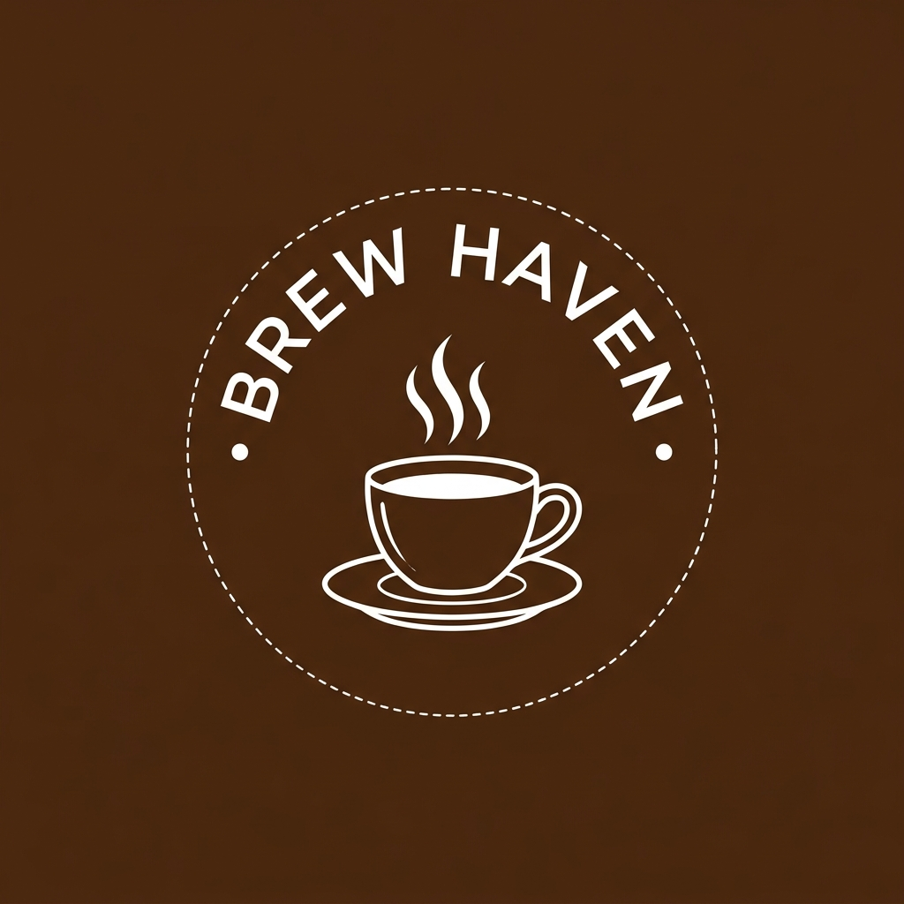

<div align="center">
  
  <h1>☕ Brew Haven</h1>
  <p><strong>Uma experiência única e artesanal para os apaixonados por café.</strong></p>

  <p>
    
    
    
    
    
  </p>
</div>

---

## 📖 Sobre o Projeto

O **Brew Haven** é uma plataforma web desenvolvida para uma cafeteria moderna e acolhedora, focada em proporcionar aos clientes não apenas um café especial, mas uma experiência sensorial completa. 

O site combina design temático rústico e sofisticado, paleta de cores inspirada em grãos selecionados, layout totalmente responsivo para celulares, tablets e desktops, além de canais integrados para contato e localização em tempo real.

---

## ✨ Funcionalidades Principais

- 🏷️ **Identidade de Marca Brew Haven**: Logotipo exclusivo, tipografia harmônica e identidade visual aconchegante.
- 📋 **Cardápio Exclusivo**: Apresentação visual de bebidas especiais com fotos e descrições:
  - *Coffee-shake*: Milk-shake cremoso de café com chantilly, chocolate e leite.
  - *Coffee Ice*: Café com sorvete de creme, chocolate amargo e leite.
  - *Coffee Monk*: Café encorpado com cobertura suave de chantilly.
  - *Coffee Cookie*: Deliciosa mistura com calda de chocolate, leite e biscoito batido.
  - *Coffee Mirna*: Café suave combinado com biscoitos finos, chocolate e leite.
  - *Coffee Palace*: Combinação marcante de café com leite, chantilly e paçoca artesanal.
- 📍 **Localização Integrada**: Mapa dinâmico via Google Maps interativo para fácil navegação até o estabelecimento na Tijuca, Rio de Janeiro.
- 🎥 **Vídeo - Nosso Segredo**: Player de vídeo incorporado demonstrando métodos de preparo e o cuidado com cada xícara.
- 📝 **Formulário de Contato**: Envio de mensagens com validação de campos (nome, e-mail, assunto e mensagem).
- 📞 **Canais de Atendimento e Detalhes Alternativos**: Bloco completo com canais diretos e horários de atendimento.
- 📱 **Totalmente Responsivo**: Otimizado para visualização fluida em dispositivos móveis, tablets e monitores widescreen.

---

## 📬 Canais de Atendimento & Detalhes de Contato

Você pode entrar em contato com a equipe **Brew Haven** através de qualquer um dos nossos canais oficiais:

| Canal | Detalhe |
| :--- | :--- |
| **E-mail Principal** | [contact@brewhaven.cafe](mailto:contact@brewhaven.cafe) |
| **E-mail Alternativo / Suporte** | [support@brewhaven.cafe](mailto:support@brewhaven.cafe) |
| **Telefone / WhatsApp** | [+55 (21) 98765-4321](tel:+5521987654321) / +55 (21) 3214-5678 |
| **Endereço Físico** | Rua Conde de Bonfim, 1024 - Tijuca, Rio de Janeiro - RJ, Brasil |
| **Horário de Funcionamento** | Segunda a Sábado: 07:00 às 20:00<br>Domingos e Feriados: 08:00 às 18:00 |
| **GitHub Oficial** | [github.com/brewhaven](https://github.com/brewhaven) |
| **LinkedIn Oficial** | [linkedin.com/company/brewhaven](https://www.linkedin.com/company/brewhaven) |

---

## 📂 Estrutura do Projeto

```plaintext
Brew-Haven/
├── css/
│   ├── cabecalho.css      # Estilos do cabeçalho, logotipo e menu de navegação
│   ├── cardapio.css       # Grade, cards de produtos e tipografia do cardápio
│   ├── contato.css        # Formulário, painel de canais alternativos e responsividade
│   ├── localizacao.css    # Container e estilização do mapa do Google Maps
│   ├── principal.css      # Cores base, container e banner principal
│   ├── reset.css          # Reset de estilos para consistência entre navegadores
│   ├── rodape.css         # Rodapé com dados de contato, copyright e redes sociais
│   ├── segredo.css        # Seção do vídeo institucional e detalhes da receita
│   └── sobre.css          # Seção sobre a cafeteria, história e apresentação
├── imagens/               # Ativos visuais (logo Brew Haven, fotos de cafés, ícones)
│   ├── logo.png           # Logotipo oficial Brew Haven
│   ├── banner.png         # Banner principal
│   ├── contato.jpg        # Imagem temática da seção de contato
│   ├── sobre.jpg          # Fotografia da cafeteria
│   └── ...                # Imagens dos itens do cardápio e ícones sociais
├── index.html             # Página web principal estruturada com HTML5 semântico
└── README.md              # Documentação completa do projeto
```

---

## 🛠️ Tecnologias Utilizadas

- **HTML5**: Estrutura semântica (`<header>`, `<main>`, `<section>`, `<nav>`, `<footer>`, `<form>`).
- **CSS3 Puro**: Estilização modularizada, Flexbox, media queries responsivas e transições suaves.
- **Google Maps Embed API**: Mapa geolocalizado interativo.
- **YouTube Embed API**: Integração de vídeo de demonstração.

---

## 🚀 Como Executar o Projeto Localmente

1. **Clone ou baixe o repositório:**
   ```bash
   git clone https://github.com/brewhaven/brew-haven.git
   ```
   *(ou extraia o arquivo `.zip` para uma pasta de sua escolha)*

2. **Acesse o diretório do projeto:**
   ```bash
   cd Brew-Haven
   ```

3. **Abra o arquivo `index.html`:**
   - Dê um duplo clique no arquivo [index.html](file:///c:/Users/QBS%20Accounting/Documents/websites/Brew-Haven/index.html) para abri-lo diretamente no seu navegador favorito; ou
   - Se estiver utilizando o **VS Code**, use a extensão **Live Server** clicando com o botão direito em `index.html` e selecionando *"Open with Live Server"*.

---

## 📄 Licença

Este projeto está sob a licença [MIT](https://opensource.org/licenses/MIT). Sinta-se à vontade para utilizar e personalizar.

<div align="center">
  <sub>© 2026 Brew Haven. Todos os direitos reservados.</sub>
</div>
